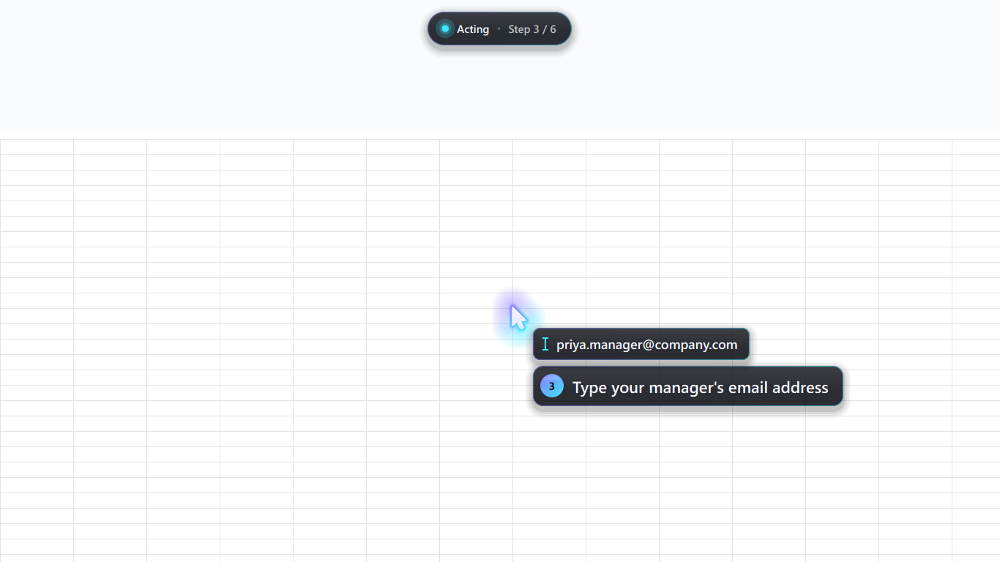

# Ghost Hands 👻🖱️

**Ask how. Watch it happen on your screen. Then do it yourself.**

Ask "how do I ___ in this app?" A ghost cursor does it on your real Windows screen at human speed, narrating every step, then coaches you through doing it yourself.

**Site:** https://ghost-hands-six.vercel.app · **Demo video:** https://ghost-hands-six.vercel.app/#demo



<sub>The overlay mid-step: ghost cursor with glow, live typing chip, a step-numbered caption, and the HUD pill (Step 3 / 6). The overlay is excluded from screen capture, so the model never sees it. This still comes from the overlay's debug "room view" renderer.</sub>

## The problem

Learning software means pausing a tutorial six times to copy one click, from a screen that doesn't look like yours.
AI agents that "just do it" leave you no better at doing it yourself.

## What it does

1. **Ask.** Hold **F8** and say the task, or press **F7** and type it.
2. **The ghost does it on your screen.** A glowing cursor glides to each real target, then clicks or types there. Each step gets a caption and a spoken line. Verified end to end on Notepad ("open Notepad and type hello") and Windows Settings ("turn on dark mode in Windows", 6 steps).
3. **Your turn.** Press **F9** and the last run comes back as pulsing rings, one per step. Ghost Hands waits for *your* real click on each one: a hit goes mint, a miss shakes the ring, and after two misses the ghost demonstrates.
4. **Safety stop.** Before every click, it reads the UI Automation name under the cursor. Send, Pay, Delete, Submit, Buy, Transfer and similar actions are refused in code, not in the prompt. The ghost parks with an amber lock and says *"Stopped before Send. That one is yours."*
5. **Grab the mouse to take over.** A deliberate mouse move freezes the run instantly: "You've got it ✋". **Esc** also stops everything.

## Built on OpenAI DevDay 2026

- **GPT-6.1 Sol + the computer-use tool** (Responses API, `tools=[{"type":"computer"}]`). The model sees screenshots and returns batched actions with short commentary, which become the captions.
- **OpenAI speech-to-text** (`gpt-transcribe`) for push-to-talk.
- **OpenAI text-to-speech** (`gpt-4o-mini-tts`, voice *marin*, streamed): a calm teacher voice narrates each step.
- **Planned and reviewed with Codex.** Codex built the brain (agent loop, executor, guard, voice) in parallel with the overlay.

## How it works

```
 F8 voice / F7 text ──▶ brain thread: screenshot (mss) ──▶ GPT-6.1 Sol computer-use ──▶ actions + captions
   guard: UI Automation name under (x,y) matches Send/Pay/Delete…? ──▶ HandOver, stop
   GhostAction ──▶ Qt overlay (60 fps, click-through, capture-excluded) glides + captions ──▶ ack
   executor (pyautogui) performs the real click/type ──▶ TTS speaks ──▶ new screenshot ──▶ loop
   every step is logged to runs/<id>/steps.json ──▶ F9 coach rings · F10 replay without AI
```

### Engineering worth a look

- **Invisible to the model.** `SetWindowDisplayAffinity(WDA_EXCLUDEFROMCAPTURE)` keeps the ghost out of every screenshot. It fails on `UpdateLayeredWindow` windows, so the overlay composites through a GL child widget.
- **Click-through, never steals focus.** Frameless, transparent-for-input, `WS_EX_NOACTIVATE` tool window.
- **60 fps on a laptop iGPU.** PyQt6, prebaked glow pixmaps, eased arc glides, a 22-point comet trail.
- **Clicks land exactly.** Per-monitor DPI aware (`SetProcessDpiAwareness(2)`), correct at 125% and 150% scaling.
- **Crash-proof UI Automation.** The accessibility probe runs in an isolated helper process (`ghost/brain/uia_host.py`).
- **Replayable.** Every run is saved to `runs/<id>/` with `steps.json`, target crops and cached voice, so **F10** replays with zero AI calls.

## Safety

- Before every click, `guard.py` reads the UI Automation name under the point. Send, Pay, Delete, Submit, Post, Buy, Transfer, Checkout, Place order, Sign out and similar are refused in code. The ghost parks with an amber lock: *"Stopped before Send. That one is yours."*
- `pending_safety_checks` from the model are never auto-acknowledged; they hand control back to you.
- Move the mouse deliberately and the run freezes ("You've got it ✋"). **Esc** stops everything. pyautogui's corner failsafe stays on.

## How to run (Windows 10/11, Python 3.11+, an OpenAI API key)

```powershell
git clone https://github.com/Arham-Begani/ghost-hands
cd ghost-hands
python -m venv .venv
.venv\Scripts\activate
pip install -r requirements.txt
```

Create `.env` in the repo root:

```
OPENAI_API_KEY=sk-...
GH_MODEL=gpt-6.1-sol
```

Optional settings: `GH_TEACH_PACE=1.0` (seconds between steps), `GH_MAX_TURNS=25`, `GH_SCREEN_MAX_W=1440`, `GH_TTS_VOICE=marin`, `GH_VOICE=0` (mute narration).

```powershell
python main.py              # real brain
python main.py --fake       # no API key needed: scripted demo of the overlay
```

| Key | Does |
|---|---|
| **F8** (hold, release) | Talk: say the task, release to run |
| **F7** | Type the task into a small glass box |
| **F9** | Your turn: coach me through the last run |
| **F10** | Replay the last run with no model calls |
| **Esc** | Stop everything |
| *move the mouse* | Take over mid-run |

Demo tasks we use: Google Sheets ("freeze the top row", "make a bar chart of sales by month", "highlight sales above 50,000 in green", "split the names into first and last name"; seed data in `demo/sales.tsv`), Windows Settings ("turn on dark mode"), and "send this sheet to my manager", which stops at Send.

## File map

| Path | What |
|---|---|
| `main.py` | DPI awareness, `.env`, picks the real or fake brain, starts Qt + hotkeys |
| `ghost/contracts.py` | Shared events and queues between brain and overlay |
| `ghost/brain/agent.py` | Responses API computer-use loop, captions from commentary |
| `ghost/brain/screen.py` | mss capture, downscale to <= 1440 px, coordinate mapping |
| `ghost/brain/executor.py` | pyautogui click / type / keypress / scroll / drag |
| `ghost/brain/guard.py`, `uia_rules.py`, `uia_host.py` | UIA hard stops, mouse-grab takeover, isolated UIA helper |
| `ghost/brain/voice.py` | Push-to-talk STT and streamed TTS (pyttsx3 offline fallback) |
| `ghost/brain/runlog.py`, `replay.py` | `runs/<id>/steps.json` + crops + voice; F10 replay |
| `ghost/brain/worker.py`, `cli.py` | Brain thread; headless test `python -m ghost.brain.cli "..."` |
| `ghost/overlay/app.py` | Full-screen click-through, capture-excluded window, event pump |
| `ghost/overlay/cursor.py`, `caption.py`, `hud.py`, `fx.py` | Ghost + trail + cues, caption bubble, HUD pill, splash / lock / burst FX |
| `ghost/overlay/coach.py` | F9 "Your turn" rings, listens for your real clicks |
| `ghost/overlay/hotkeys.py`, `taskbox.py` | Global hotkeys, F7 typed-task box |
| `ghost/overlay/fake_brain.py` | Scripted demo for `--fake` (no API key) |
| `web/` | Landing page (static, deployed on Vercel) |

## Troubleshooting

- **Clicks land in the wrong place.** Keep Windows display scaling fixed while running (100%, 125% or 150% all work) and don't change it between recording a run and replaying it with F10. Run on the primary monitor.
- **Projector / second screen.** Use Windows display mode **Duplicate** (Win+P) at one resolution. In Extend mode the overlay and the screenshots cover only the primary monitor.
- **The ghost shows up in screenshots.** Needs Windows 10 2004 or later for `WDA_EXCLUDEFROMCAPTURE`; the log warns if the call fails.
- **Clicks do nothing in one app.** That app is running as administrator; input from a normal process is blocked. Don't demo admin apps.
- **No voice.** Check the default mic and speakers; set `GH_VOICE=0` to run with captions only, or use **F7** to type instead of talking.
- **API stalls mid-demo.** Press **F10** to replay the last good run with no model calls.

## What's next

- Live click-level coaching that watches what *you* do and corrects you in real time, not just replays a recorded path.
- A shareable library of recorded runs ("how we do expenses here"), so a team's know-how becomes something a new hire can watch on their own screen.
